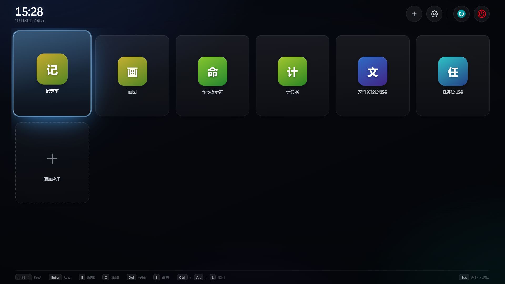
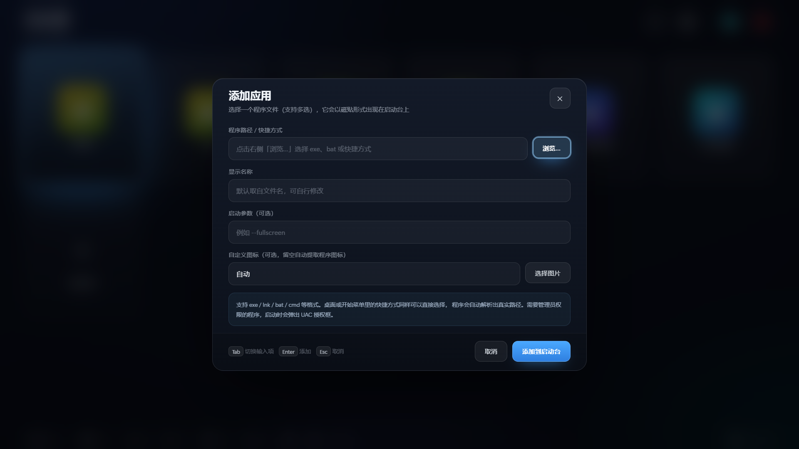

<div align="center">

# 影音快启 · LaunchPlay

**把 Windows 电脑变成一台电视。**

深色客厅、大图标磁贴、遥控器选台——开机即进，选一个就播。


[功能](#功能) · [截图](#截图) · [快速开始](#快速开始) · [快捷键](#操作一览) · [从源码构建](#从源码构建) · [常见问题](#常见问题)

</div>



---

## 这是什么

把一台接在电视上的 Windows 电脑，变成一台"电视"：

开机 → 看到一屏大图标 → 用遥控器方向键选 → 按 OK 打开。关掉应用，回到这一屏。

它不扫描你的硬盘、不联网、不上传任何东西。你手动把常用的播放器、浏览器、游戏、直播站加进来，它负责把这一屏做得像电视首页：

- **像电视**：无边框全屏、深色背景、超大磁贴、清晰的焦点高亮
- **像遥控器**：方向键 / 手柄十字键 / 键盘，全都能操作
- **像首页**：打开应用后启动台留在下层，关掉应用自动回到这一屏

> 适用于 HTPC、客厅电脑、投影、一体机、旧笔记本改电视盒子等场景。

## 功能

| 能力       | 说明                                                         |
| -------- | ---------------------------------------------------------- |
| 手动添加应用   | 选择 exe / lnk / bat / cmd / 网址，支持**一次多选**，自动读取文件名作为显示名      |
| 高清图标     | 直接从 exe 的 PE 资源中取 **256×256** 原图，不是把 32px 放大；取不到时退化为渐变字母磁贴 |
| 编辑 / 移除  | 按 `E` 或右键即可改名、改路径、换图标、移除（只从启动台移除，**不卸载**）                  |
| 关机 / 重启  | 右上角图标按钮，二次确认后执行                                            |
| 方向键焦点    | 空间导航算法：上下左右自动寻找最近的磁贴，当前项高亮 + 缩放 + 光晕                       |
| 启动后不收起   | 启动台留在新窗口下层，像电视首页；关掉应用即回到这一屏                                |
| 新窗口铺满置顶  | 启动后自动把目标窗口铺满当前显示器并置顶（可在设置里关闭）                              |
| 一键唤回     | 全局热键 `Ctrl+Alt+L`，随时把启动台拉回前台                               |
| 遥控器 / 手柄 | 标准 Gamepad 映射：十字键移动、A 确认、B 返回                              |
| 开机自启     | 写入 `HKCU\...\Run`，一键开关，失败不破坏开关状态                           |
| 全屏沉浸     | 默认无边框全屏，`F11` 切换窗口模式                                       |
| 自定义背景    | 设置 → 外观选一张自己的图片当墙纸，可调暗度、开关虚化；图片存进数据目录，原图挪走也不裂 |
| 本地持久化    | 应用列表与设置存在 exe 同级的 JSON 文件里，拷走整个文件夹即可迁移                     |

## 截图

| 主界面 | 自定义背景 | 设置 |
| --- | --- | --- |
|  |  |  |

添加应用面板：



## 快速开始

1. 从 [Releases](../../releases) 下载 `LaunchPlay-x.y.z-portable.exe`（单文件免安装，约 71 MB，无需 .NET / 运行库）。
2. 双击运行。首次启动会自动打开「添加应用」。
3. 点「浏览…」选一个程序（可多选），回车确认。
4. 之后按 `C` 随时添加，`S` 打开设置。

> **建议**：把 exe 放在一个固定目录（例如 `D:\LaunchPlay\`），它会在这个目录下生成 `LaunchPlayData\` 保存你的配置。移动 exe 后建议重新开关一次"开机自启"。

## 启动应用后的行为

点开应用后，启动台**不会收起**，而是留在新窗口下面，作为电视式"首页"常驻。

- 启动时只做两件事：取消置顶、把键盘焦点让给新程序。新窗口由系统拉到前台，层级上正好压在启动台之上。
- 想彻底隐藏启动台：设置里打开「启动后收起启动台」。
- 想手动切回来：`Ctrl+Alt+L`。在应用下层时按一下拉到前台，已在前台时按一下收起。
- 如果该热键被其他软件占用，会自动退化为"不收起"，避免回不来。

## 操作一览

| 操作         | 键盘                          | 遥控器 / 手柄     |
| ---------- | --------------------------- | ------------ |
| 移动焦点       | `← ↑ ↓ →`                   | 方向键 / 十字键    |
| 启动应用       | `Enter` / `Space`           | `OK` / `A`   |
| 返回 / 关闭弹层  | `Esc`                       | `Back` / `B` |
| 退出启动器      | `Esc` 连按两次                  | —            |
| 添加应用       | `C`                         | —            |
| 编辑 / 移除    | `E` / `Del`                 | —            |
| 设置         | `S`                         | —            |
| 切回 / 收起启动台 | `Ctrl+Alt+L`                | —            |
| 全屏切换       | `F11`                       | —            |
| 关机 / 重启    | `Ctrl+Alt+P` / `Ctrl+Alt+R` | 右上角按钮        |

鼠标：单击启动，右键编辑。

## 数据与自启

| 项目   | 位置                                                              |
| ---- | --------------------------------------------------------------- |
| 配置   | `exe 同级\LaunchPlayData\launcher.json`                           |
| 图标缓存 | `exe 同级\LaunchPlayData\icons\`                                  |
| 背景图片 | `exe 同级\LaunchPlayData\backgrounds\`（只保留当前使用的一张）               |
| 回退位置 | `%APPDATA%\LaunchPlay`（exe 所在目录不可写时）                            |
| 开机自启 | `HKCU\Software\Microsoft\Windows\CurrentVersion\Run\LaunchPlay` |

- exe 放在 `C:\Program Files` 下时，Windows 会阻止写入同级目录，数据会自动落到 `%APPDATA%\LaunchPlay`。
- 从 1.x（TVLauncher）升级时，会自动把旧的 `TVLauncherData\` 复制一次到 `LaunchPlayData\`。

## 系统要求

- Windows 10 1809 及以上 / Windows 11，x64
- 无需 .NET、无需 Visual C++ 运行库、无需管理员权限
- 建议 1920×1080 及以上分辨率（为 16:9 大屏设计）

## 从源码构建

```bash
git clone https://github.com/Taby-Ding/launchplay.git
cd launchplay
npm install
npm start          # 开发运行
npm run dist       # 打包免安装 exe -> release/
```

其他脚本：

```bash
npm run icon              # 重新生成 build/icon.ico
npm run prepare-electron  # 只生成精简版 Electron 运行时（dist 前会自动执行）
```

### 构建说明

- `npm run dist` 会自动把 `node_modules/electron/dist` 复制成 `build/electron-dist`，并**只保留 `zh-CN` / `en-US` 两个语言包**，产物从 ~150 MB 降到 ~71 MB。
- 首次打包需要联网下载 NSIS 工具链。国内网络可设置：
  ```bash
  export ELECTRON_BUILDER_BINARIES_MIRROR=https://registry.npmmirror.com/-/binary/electron-builder-binaries/
  ```
- 产物在 `release/LaunchPlay-<version>-portable.exe`。

## 项目结构

```
src/
  main.js          主进程：窗口、IPC、启动、电源、开机自启、图标协议
  preload.js       contextBridge 安全桥（contextIsolation + sandbox）
  peicon.js        PE 资源图标解析 + PNG 编码（纯 JS，零依赖）
  iconcache.js     图标提取与磁盘缓存
  lnk.js           .lnk 快捷方式解析
  store.js         JSON 持久化（临时文件 + rename 原子写）
  winboost.js      常驻 PowerShell 辅助进程：新窗口铺满 + 置顶
  renderer/        界面（原生 HTML / CSS / JS，无框架、无构建步骤）
tools/
  make-icon.js         自绘多尺寸 ICO
  prepare-electron.js  生成精简版 Electron 运行时
```

### 几个实现要点

- **图标提取**：自己写了 PE 资源解析器（`peicon.js`），遍历 `.rsrc` 中的图标目录条目（而不是按数字 ID 找，因为很多程序的图标是命名资源），优先取 PNG 压缩条目，否则解码 DIB 再重新编码为 PNG。全程零原生依赖。
- **Windows 窗口增强**：需要 `SetWindowPos`，但 Node 没有原生绑定。这里用一个**常驻的 PowerShell 辅助进程**：预热一次，把 C# 代码编译成 DLL 缓存，之后走行协议通信，避免每次冷启动 3.5 秒的开销。
- **焦点导航**：不做网格下标计算，而是在所有磁贴里按方向做空间搜索（比较中心点偏移与垂直距离），所以不等宽的磁贴、最后一行不满时也能走对。

## 已知限制

- Windows 没有公开接口把**别的程序**变成真全屏（独占全屏），本项目只能做到"铺满 + 隐藏任务栏"，视觉上等价。
- `.lnk` 快捷方式和协议链接拿不到子进程 PID，因此"新窗口铺满置顶"对它们不生效。
- 启动台在前台时，`Esc` 会发给前台应用；回到首页请用 `Ctrl+Alt+L` 或 `Alt+Tab`。
- 部分程序（如 UWP 应用、二级启动器）启动后会拉起另一个进程，窗口增强可能不生效。

## 常见问题

**图标是空的 / 显示首字母？**  
说明该程序本身没有可用的大图标（图标在 DLL 里，或只有 16px）。此时会退化成渐变字母磁贴。可以在「编辑应用」里手动指定一张图片。

**点应用没反应？**  
需要管理员权限的程序会触发 UAC 提示；路径失效时会直接提示"路径不存在"。

**杀毒软件报毒？**  
免安装版是自解压 exe，部分杀软会对这类单文件包误报。可以加入信任，或用 `npm run dist` 自行构建。

**重启后列表丢了？**  
检查 `LaunchPlayData` 是否可写。如果 exe 在 `C:\Program Files` 下，Windows 会阻止写入，数据会存到 `%APPDATA%\LaunchPlay`。

## 贡献

欢迎 Issue 和 PR。提交前请先看 [CONTRIBUTING.md](CONTRIBUTING.md)。

本项目没有构建步骤、没有前端框架、没有运行时依赖，改完 `src/renderer/` 直接 `npm start` 就能看到效果。

## License

[MIT](LICENSE) © LaunchPlay contributors

本项目与 Microsoft、Xbox、Steam 等公司无任何关联，仅作为个人使用的桌面工具。
