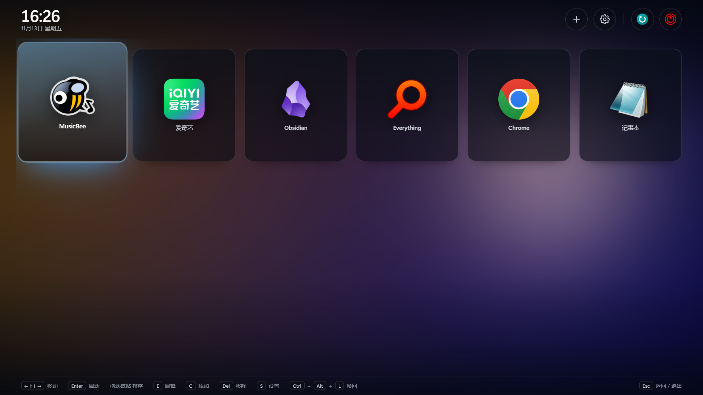
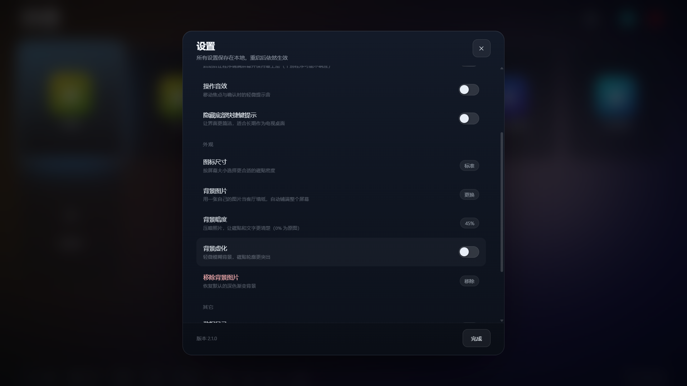

<div align="center">

# 影游快启

**把电脑变成一台电视。**

深色客厅、大图标磁贴、遥控器选台——开机即进，选一个就播。


[下载](#下载) · [功能](#功能) · [截图](#截图) · [快速开始](#快速开始) · [快捷键](#操作一览) · [从源码构建](#从源码构建) · [常见问题](#常见问题)

</div>


---

## 下载

| 平台 | 架构 | 文件 | 大小 | 说明 |
| --- | --- | --- | --- | --- |
| **Windows 10/11**（推荐） | x64 | [LaunchPlay-1.0.0-windows-x64-setup.exe](https://github.com/Taby-Ding/launchplay/releases/download/v1.0.0/LaunchPlay-1.0.0-windows-x64-setup.exe) | ~78 MB | **安装版**：装一次到固定目录，之后启动最快；支持「设置 → 关于」里一键检查更新 |
| **Windows 10/11** | x64 | [LaunchPlay-1.0.0-windows-x64.exe](https://github.com/Taby-Ding/launchplay/releases/download/v1.0.0/LaunchPlay-1.0.0-windows-x64.exe) | ~71 MB | 免安装便携版：单文件双击即用，不用安装，但每次启动都要自解压 |
| **Windows 7**（专用版·安装） | x64 | [LaunchPlay-1.0.0-windows-x64-win7-setup.exe](https://github.com/Taby-Ding/launchplay/releases/download/v1.0.0/LaunchPlay-1.0.0-windows-x64-win7-setup.exe) | ~62 MB | **推荐**：装一次到固定目录，启动快；Win7 / Win10 / Win11 均可运行 |
| **Windows 7**（专用版·免安装） | x64 | [LaunchPlay-1.0.0-windows-x64-win7-portable.zip](https://github.com/Taby-Ding/launchplay/releases/download/v1.0.0/LaunchPlay-1.0.0-windows-x64-win7-portable.zip) | ~85 MB | 解压到任意文件夹，双击 `LaunchPlayWin7.exe` 即用，无需安装、无需管理员权限 |
| **Linux** | x64 | [LaunchPlay-1.0.0-linux-x64.AppImage](https://github.com/Taby-Ding/launchplay/releases/download/v1.0.0/LaunchPlay-1.0.0-linux-x64.AppImage) | ~86 MB | 通用单文件，`chmod +x` 后直接运行 |
| **Linux** | x64 | [LaunchPlay-1.0.0-linux-x64.tar.gz](https://github.com/Taby-Ding/launchplay/releases/download/v1.0.0/LaunchPlay-1.0.0-linux-x64.tar.gz) | ~106 MB | 解压即用的绿色目录，AppImage 跑不起来时用它 |

> 全部产物都在 [Releases](https://github.com/Taby-Ding/launchplay/releases/tag/v1.0.0) 页面。
>
> **两个 Windows 版本怎么选（启动时间对比）**：
>
> | 版本 | 首次安装 | 每次启动 | 应用内更新 | 适合 |
> | --- | --- | --- | --- | --- |
> | 安装版 setup.exe | 需安装一次 | **约 2–3 秒** | ✅ 支持 | 长期使用，推荐 |
> | 便携版 exe | 无需安装 | 约 8–10 秒（每次自解压 70MB + 杀软扫描） | ❌ 需手动下载新版 | 临时用、不想装到系统 |
>
> 便携版每次双击都要把整个程序解压到临时目录，慢就慢在这里；安装版装一次后不再解压，所以快很多。
>
> **Win7 用户请下载专用版**（`-win7-setup.exe` 或 `-win7-portable.zip`）：主版本基于 Electron 38，从 Electron 23 起官方已不支持 Win7，无法在 Win7 启动；专用版基于 Electron 22 单独构建，与上面两个版本完全隔离（独立 AUMID 和数据目录，可共存），在 Win10/11 上也能运行。它要求 Win7 SP1，并建议先装 KB2533623、KB2670838 两个补丁（精简版系统常见缺失，缺了会打不开）。Win7 版不支持应用内自动更新，请在「关于」里点「打开下载页」手动获取新版。早期提供的单文件 `-win7.exe` 自解压版在部分系统上启动后会立即退出，已停用，请改用安装版或解压版。
>
> Linux 的 AppImage / tar.gz 由 CI 在 Ubuntu runner 上构建（原因见[构建说明](#构建说明)）。Release 里的 Windows、Win7、Linux 资产均基于同一份源码重新构建；Windows 包与 Linux tar.gz 已验证可运行。

### 各平台首次运行

**Windows**：双击 exe 即可。免安装版是自解压包，部分杀软会对这类单文件包误报，可加入信任或自行构建。

**Linux**：

```bash
chmod +x LaunchPlay-1.0.0-linux-x64.AppImage
./LaunchPlay-1.0.0-linux-x64.AppImage
```

如果提示缺少 FUSE，装一下 `libfuse2`（Ubuntu/Debian：`sudo apt install libfuse2`），或者改用 tar.gz 版本：

```bash
tar -xzf LaunchPlay-1.0.0-linux-x64.tar.gz
cd LaunchPlay-1.0.0-linux-x64
./launchplay
```

如果启动时报 `The SUID sandbox helper binary was found, but is not configured correctly`，说明当前系统禁用了非特权用户命名空间（部分 Ubuntu 24.04 默认如此）。两种解法：给 sandbox 加 setuid（`sudo chown root:root chrome-sandbox && sudo chmod 4755 chrome-sandbox`），或者加 `--no-sandbox` 启动。

## 这是什么

把一台接在电视上的电脑，变成一台"电视"：

开机 → 看到一屏大图标 → 用遥控器方向键选 → 按 OK 打开。关掉应用，回到这一屏。

它不扫描你的硬盘、不联网、不上传任何东西。你手动把常用的播放器、浏览器、游戏、直播站加进来，它负责把这一屏做得像电视首页：

- **像电视**：无边框全屏、深色背景、超大磁贴、清晰的焦点高亮
- **像遥控器**：方向键 / 手柄十字键 / 键盘，全都能操作
- **像首页**：打开应用后启动台留在下层，关掉应用自动回到这一屏

> 适用于 HTPC、客厅电脑、投影、一体机、旧笔记本改电视盒子等场景。

## 平台能力对照

同一份界面，两个系统能给的能力不一样，差别都在系统接口上：

| 能力 | Windows | Linux |
| --- | :---: | :---: |
| 全屏磁贴启动台 | ✅ | ✅ |
| 图标自动提取 | ✅ exe/dll 的 PE 资源，原生 256px | ✅ `.desktop` + 图标主题，png/svg |
| 新窗口铺满并置顶 | ✅ Win32 `SetWindowPos` | — 无对应接口 |
| 开机自启 | ✅ 注册表 `HKCU\...\Run` | ✅ XDG autostart |
| 关机 / 重启 | ✅ `shutdown.exe` | ✅ `systemctl` |
| 提权启动 | ✅ UAC `RunAs` | — |
| UWP 应用 | ✅ | — |
| 遥控器 / 手柄 | ✅ | ✅ |
| 全局唤回热键 | ✅ | ✅ |

> Linux 上"新窗口铺满并置顶"在设置里会显示为「仅 Windows 支持」并且不可点——不是藏起来，而是确实没有等价的可移植接口（要按窗口管理器逐个适配，做一半反而更让人困惑）。

## 功能

| 能力 | 说明 |
| --- | --- |
| 手动添加应用 | 选程序文件，支持**一次多选**，自动读取名称与图标 |
| 高清图标 | Windows 从 exe/dll 的 PE 资源取 256×256 原图，`.lnk` / `.url` 快捷方式自动解析真实目标与图标位置（含 Steam / Epic 游戏）；Linux 从 `.desktop` 与图标主题取 512→png/svg；取不到时退化为渐变字母磁贴 |
| 编辑 / 移除 | 按 `E` 或右键即可改名、改路径、换图标、移除（只从启动台移除，**不卸载**） |
| 拖动排序 | 按住磁贴拖到想要的位置，松手即保存顺序（拖动超过 8px 才生效，不影响单击启动） |
| 关机 / 重启 | 右上角图标按钮，二次确认后执行 |
| 方向键焦点 | 空间导航算法：上下左右自动寻找最近的磁贴，当前项高亮 + 缩放 + 光晕 |
| 启动后不收起 | 启动台留在新窗口下层，像电视首页；关掉应用即回到这一屏 |
| 新窗口铺满置顶 | 启动后自动把目标窗口铺满当前显示器并置顶（仅 Windows，可在设置里关闭） |
| 一键唤回 | 全局热键 `Ctrl+Alt+L`，随时把启动台拉回前台 |
| 遥控器 / 手柄 | 标准 Gamepad 映射：十字键移动、A 确认、B 返回 |
| **手机遥控** | 扫码即可用手机当遥控器：方向键导航、确定启动、返回、唤出/收起；导航键**任何时候都只做导航**，不再变成音量/快进；另有独立播放遥控区、鼠标触摸板、键盘输入（支持中文）、常驻二维码角标、关闭程序、关机重启。大字版 / 标准版一键切换，可自定义 4 个万能键。同一 WiFi 即可，6 位随机配对码，默认开启（详见下方专节） |
| 左上角天气 | 时间后面显示城市 + 天气 + 气温；默认按 IP 自动定位，也可**先选省份再选城市**（全国 34 个省级行政区 / 369 个城市）；取不到时自动隐藏，不影响其它功能 |
| 定时关机 | 设置里选小时和分钟（例如 0 小时 10 分钟），到点自动关机，可随时取消 |
| **家长守护** | 家长密码保护进设置，禁止添加应用 / 切回桌面 / 退出程序；按**现实时间**累计使用时长（重启不清零、关机期间不计时）；每隔 N 分钟强制休息 M 分钟，支持答题提前解锁与自定义题库；可选轻量加固（防切桌面 + 被关闭后自动恢复） |
| 开机自启 | 两个平台都是用户级自启，不需要管理员 / root，一键开关，失败不破坏开关状态 |
| 全屏沉浸 | 默认无边框全屏，`F11` 切换窗口模式 |
| 默认背景 | 自带一张柔和的电视渐变壁纸，开箱就有客厅感；也可换成自己的图片 |
| 自定义背景 | 设置 → 外观选一张自己的图片当墙纸，可调暗度、开关虚化；图片存进数据目录，原图挪走也不裂 |
| 本地持久化 | 应用列表与设置存在一个 JSON 文件里，拷走整个数据目录即可迁移 |

## 截图

| 主界面 | 自定义背景 | 设置 |
| --- | --- | --- |
|  |  |  |

添加应用面板：


## 快速开始

1. 从上面的表格里挑对应平台的包下载。
2. 运行。首次启动会自动打开「添加应用」。
3. 点「浏览…」选一个程序（可多选），回车确认。
   - Windows：选 `.exe`，或桌面/开始菜单里的 `.lnk`（会自动解析出真实路径）
   - Linux：选 `/usr/share/applications` 里的 `.desktop`，或可执行文件、AppImage
4. 之后按 `C` 随时添加，`S` 打开设置。

> **Windows 建议**：把 exe 放在固定目录（例如 `D:\LaunchPlay\`），它会在同级生成 `LaunchPlayData\`。移动 exe 后建议重新开关一次"开机自启"。

## 启动应用后的行为

点开应用后，启动台**不会收起**，而是留在新窗口下面，作为电视式"首页"常驻。

- 启动时只做两件事：取消置顶、把键盘焦点让给新程序。新窗口由系统拉到前台，层级上正好压在启动台之上。
- 想彻底隐藏启动台：设置里打开「启动后收起启动台」。
- 想手动切回来：`Ctrl+Alt+L`。在应用下层时按一下拉到前台，已在前台时按一下收起。
- 如果该热键被其他软件占用，会自动退化为"不收起"，避免回不来。

## 手机遥控（扫码）

把手机变成遥控器，躺在沙发上就能控制这台"电视"。

**用法**

1. 电脑上运行 LaunchPlay，按 `S` 打开设置 →「扫码用手机遥控」→「开启」。
2. 屏幕上出现二维码；用**手机相机**扫码，浏览器会打开遥控页（无需安装 App）。
3. 手机和电脑必须连接**同一个 WiFi**。扫不出来时，也可以在手机浏览器手动输入二维码下方显示的网址。
4. 开启后，大屏角落会**常驻一个小二维码**，随时可扫码重连；点它看大图，按住可拖到不碍事的位置（位置会记住）。

**能做什么**

- **导航键始终只做导航**：方向键移动高亮、确定启动、返回关闭弹层，任何时候都**不会**自动变成音量加减或快进快退。看视频请用下面的「播放遥控」卡片里的独立按钮。
- **自动跳到播放遥控卡片**：打开程序后手机页自动滚到播放遥控区，启动台回到最上层时自动滚回导航卡片。这只是滚动定位，**不改变任何按键功能**。
- **字号切换**：页头一个按钮在「大字版」与「标准版」之间切换。大字版是当前尺寸（最初版的 2 倍），标准版是最初版的 1.5 倍（即大字版的 0.75）；切换时字号、按钮高度、触摸板、图标一起等比缩放，每台手机各自记住选择。
- **万能键**：设置 → 实用工具 → 万能键，可自定义最多 4 个按键组合（如 `Ctrl+Alt+F5`、`Alt+Enter`、`Win+D`），手机页会自动出现对应按钮。配置**只保存在电脑端**，具体组合不会下发到手机。
- **播放遥控区**：独立的播放/暂停、快进、快退、全屏、音量、静音、下一集按钮，直接控制正在看的视频。
- **鼠标**：触摸板上滑动移动光标，轻点左键、长按右键；另有左键/右键/上下滚轮按钮。
- **键盘**：手机输入框打中文或英文，点「发送」直接输入到电脑前台程序；另有回车/Esc/空格/退格/方向键快捷键。
- 一键唤出 / 收起启动台；系统音量、静音、上一曲/下一曲。
- 关闭刚刚启动的程序、关机、重启（均需二次确认）。

> 万能键与键鼠模拟依赖 Windows 的真实键盘/鼠标注入，发给**当前前台窗口**；仅 Windows 支持。Linux 版可用方向键导航、音量与播放、唤出收起等基础遥控，键鼠注入与万能键不可用。

**安全与隐私**

- 服务**默认开启**，随程序启动自动运行，并在大屏角落常驻二维码；关闭程序即停止。
- 每次开启生成 **6 位随机配对码**写进二维码网址，手机每条指令都要带上并校验，同一 WiFi 下别人扫到也无法控制；可随时「换一个配对码」。
- 服务只监听本机局域网网卡，指令仅在本地网络传输（几个字节），**不连公网、不上传任何数据**。

**连不上怎么办**

- 确认手机与电脑在同一 WiFi（不要用访客网络 / 公司隔离网）。
- Windows 首次开启可能弹出防火墙提示，勾选「专用网络」并点允许。
- 电脑换了网络 / IP 后，回到设置重新打开此页获取新二维码。
- 自动跟随 / 键鼠模拟会在 Windows 上启动一个短暂的系统按键注入进程（内联脚本，不落盘）；若安全软件拦截，请允许。注入作用于**前台窗口**，所以要先让影音软件处于前台再按遥控键。
- 个别播放器全屏时不响应注入的按键（各版本快捷键约定不同）；此时可改用手机页面上的播放遥控区按钮。
- 系统媒体键（音量、播放）依赖系统支持：Windows 用系统媒体键，Linux 需装有 `playerctl` / `pactl` / `xdotool` 之一，个别环境可能不可用；方向键与启动不受影响。

## 天气、定时关机与家长守护

### 左上角天气

主界面左上角时间后面会显示「城市 + 天气 + 气温」。默认按网络 IP 自动定位；定位不准或不想联网定位时，到 **设置 → 实用工具 → 天气城市**，**先选省份、再选城市** —— 内置全国 34 个省级行政区 / 369 个城市的编码表（暂不含国外城市），完全离线，不依赖任何城市搜索服务。

天气由主进程代发请求（界面有严格 CSP，不允许直连外网）。按 9 位城市编码走中国天气网的实时接口（国内直连约 1 秒，含天气现象与气温）；自动定位到未收录的城市时改用 [Open-Meteo](https://open-meteo.com/) 按经纬度查询。全部失败就回落到北京实况或安静隐藏，**不影响其它功能**。结果缓存 30 分钟。

城市编码表由 `tools/build-weather-cities.js` 从中国天气网公开的省 / 市 / 站三级编码生成到 `src/weather-cities.js`；接口变动时重跑该脚本即可更新，运行时不请求这些编码接口。

### 定时关机

**设置 → 实用工具 → 定时关机**，选好小时和分钟（例如 `0 小时 10 分钟`）点「启动定时关机」，可随时回来点「取消定时关机」。

- Windows 使用系统级 `shutdown.exe /s /t`，设置成功后**即使退出本程序也会按时关机**；取消用 `shutdown.exe /a`。
- macOS / Linux 没有免 root 的等价命令，改为程序内定时器兜底，此时需要保持程序运行。
- 家长守护模式下依然可以设置定时关机。

### 家长守护模式

**设置 → 实用工具 → 家长守护模式**。首次开启需要设置家长密码（至少 4 位，只以 scrypt 哈希存盘，明文与哈希都不会下发到界面）。

开启后：

| 限制 | 说明 |
| --- | --- |
| 不能添加应用 | 隐藏「＋」按钮，并拦住添加 / 编辑 / 移除应用 |
| 不能切回电脑桌面 | 不允许收起启动台、退出全屏、最小化窗口 |
| 不能强制关掉本软件 | 拦住退出按钮、双击 `Esc`、`Alt+F4`、关机 / 重启 |
| 进设置需密码 | 每次打开设置都要重新输入家长守护密码 |
| 使用时长按现实时间算 | 累计时长与休息结束时间都用绝对时间戳落盘；重启电脑不清零，关机期间不计时，改系统时间也绕不过去 |

家长验证密码后有 **5 分钟临时放行窗口**，方便自己退出程序或整理应用；窗口过后自动重新锁定。忘记密码时，删除数据目录 `launcher.json` 里的 `parental` 字段即可重置（应用列表不受影响）。

**轻量加固（可选开关）**

同一面板里的「轻量加固」默认关闭。开启后在应用层拦截之外再加三道，且**不替换 Windows 外壳、不需要企业版/教育版、不需要管理员装驱动**：

| 措施 | 作用 |
| --- | --- |
| 用户级策略 | 禁用任务管理器与 Win 键组合；写入前把原值备份到 `lockdown-backup.json`，关闭守护或退出软件时按原值恢复 |
| 看门狗进程 | 主进程被结束后 1–2 秒自动重新拉起；正常退出前写 `quit.flag`，不会把主动退出拉回来 |
| 失焦抢回 | 启动台打开的程序已退出时把窗口拉回前台，避免露出桌面；程序还在运行时不抢，保证能正常看视频 |

**为什么不用 Windows Kiosk 模式**：Assigned Access 的单应用 Kiosk 只支持 UWP / Edge，不支持 Win32 桌面程序；Win32 要用 Shell Launcher，而它仅限企业版 / 教育版，Win7 完全没有这些功能。因此选了这套跨 Win7 / Win10 / Win11、可随软件卸载恢复的方案。

> **能力边界**：`Ctrl+Alt+Del`、长按电源键、管理员 `taskkill` 属于操作系统层面的手段，任何用户态应用都无法阻止。加固的价值是「没有桌面可切 + 被结束后自动回来」，不是「进程杀不死」。

**强制休息与答题解锁**

- 可设置「每隔 N 分钟，强制休息 M 分钟」。计时在主进程并按现实时间落盘，改界面、重启电脑都绕不过去；关机 / 系统睡眠期间不计入使用时长，但重启前的累计时长会保留，休息与答错锁定也会跨重启继续。
- 休息期间显示全屏遮罩，倒计时结束自动恢复；`Esc` 关不掉它。
- 开启「答题解锁」时，答对一道题可**立即结束休息**；**答错一次需等待 1 分钟，随后自动换一道新题**。
- 不导入题库也能用：程序内置 15 道常识题。题目与答案都留在主进程，界面只拿到题干和选项。

### 自定义题库

题库是 UTF-8 编码的 JSON 文件，格式如下：

```json
{
  "version": 1,
  "questions": [
    {
      "q": "1 + 1 = ?",
      "options": ["1", "2", "3", "4"],
      "answer": 1
    }
  ]
}
```

| 字段 | 类型 | 说明 |
| --- | --- | --- |
| `version` | 数字 | 目前固定为 `1` |
| `questions` | 数组 | 题目列表，最多 2000 道；也可以直接把数组作为文件根元素 |
| `q` | 字符串 | 题干，最长 200 字 |
| `options` | 字符串数组 | 选项，至少 2 个，每项最长 120 字 |
| `answer` | 数字 / 字符串 | **正确选项的下标，从 0 开始**；也可以直接写正确选项的文字 |

格式不合法（缺少 `q` / `options` / `answer`、下标越界）的题目会被自动跳过；一道有效题都没有时会拒绝导入并说明原因。

- **样本题库下载**：[docs/questions.sample.json](docs/questions.sample.json)（GitHub 上右键「另存为」，或打开 [raw 链接](https://github.com/Taby-Ding/launchplay/raw/main/docs/questions.sample.json) 直接保存）。
- 设置里点「**导出样本题库**」也会把一份样本写到数据目录，方便照着改。
- 点「**导入题库**」选择改好的 `.json`，校验通过后复制到数据目录 `quiz.json`，立即生效。

## 操作一览

| 操作 | 键盘 | 遥控器 / 手柄 | 手机 |
| --- | --- | --- | --- |
| 移动焦点 | `← ↑ ↓ →` | 方向键 / 十字键 | 方向键 |
| 启动应用 | `Enter` / `Space` | `OK` / `A` | 确定 |
| 返回 / 关闭弹层 | `Esc` | `Back` / `B` | 返回 |
| 退出启动器 | `Esc` 连按两次 | — | — |
| 添加应用 | `C` | — | — |
| 编辑 / 移除 | `E` / `Del` | — | — |
| 设置 | `S` | — | — |
| 切回 / 收起启动台 | `Ctrl+Alt+L` | — | 唤出/收起 |
| 全屏切换 | `F11` | — | — |
| 音量 / 播放 | — | — | 音量键 / 播放键 |
| 关闭刚打开的程序 | — | — | 关闭程序 |
| 关机 / 重启 | `Ctrl+Alt+P` / `Ctrl+Alt+R` | 右上角按钮 | 关机 / 重启 |

鼠标：单击启动，右键编辑。

## 数据与自启

| 项目 | Windows | Linux |
| --- | --- | --- |
| 配置 | `exe 同级\LaunchPlayData\launcher.json` | AppImage 同级 `LaunchPlayData/`，或 `~/.config/LaunchPlay/` |
| 图标缓存 | `LaunchPlayData\icons\` | 同上目录 `icons/` |
| 背景图片 | `LaunchPlayData\backgrounds\`（只留当前一张） | 同上目录 `backgrounds/` |
| 家长守护题库 | `LaunchPlayData\quiz.json`（导入后生成，未导入则用内置题库） | 同上目录 `quiz.json` |
| 轻量加固备份 | `LaunchPlayData\lockdown-backup.json`（加固开启期间，记录策略原值） | 同上目录 `lockdown-backup.json` |
| 正常退出标记 | `LaunchPlayData\quit.flag`（退出瞬间写入，看门狗据此不再拉起） | 同上目录 `quit.flag` |
| 回退位置 | `%APPDATA%\LaunchPlay` | `~/.config/LaunchPlay` |
| 开机自启 | `HKCU\Software\Microsoft\Windows\CurrentVersion\Run\LaunchPlay` | `~/.config/autostart/launchplay.desktop` |

- Windows 上 exe 放在 `C:\Program Files` 下时，系统会阻止写同级目录，数据会自动落到 `%APPDATA%\LaunchPlay`。
- Linux 上从 AppImage 启动时，数据写在 **AppImage 文件旁边**；如果那个位置不可写（例如放在 `/opt`），自动退到 `~/.config/LaunchPlay`。

## 系统要求

| 平台 | 要求 |
| --- | --- |
| Windows | Windows 10 1809 及以上 / Windows 11，x64；无需 .NET、无需 VC++ 运行库、无需管理员权限 |
| Windows 7 | 仅专用版（`-win7-setup.exe` 安装版或 `-win7-portable.zip` 解压版）：Win7 SP1 x64，需 KB2533623、KB2670838；不支持应用内更新 |
| Linux | x64 桌面发行版，需要图形环境（X11 或 Wayland）；推荐 glibc 2.28+ |

建议 1920×1080 及以上分辨率（为 16:9 大屏设计）。

## 从源码构建

```bash
git clone https://github.com/Taby-Ding/launchplay.git
cd launchplay
npm install
npm start              # 开发运行（Windows / Linux 通用）
```

按平台打包：

```bash
npm run dist:win       # Windows 便携 exe        -> release/LaunchPlay-<ver>-windows-x64.exe
npm run dist:linux     # AppImage + tar.gz       -> release/LaunchPlay-<ver>-linux-x64.*
```

### Windows 7 专用版

Win7 专用版**不是只有下载链接**，完整源码就在本仓库的 `launchplay-win7/` 目录：

```bash
cd launchplay-win7
npm install                       # 安装 Electron 22.3.27
npm run prepare-electron          # 生成精简运行时
npx electron-builder --win nsis --x64 --config.electronDist=build/electron-dist --publish never
```

它与主版本共用同一份 `src/`，差异只在 `package.json`（`productName` / Electron 版本）以及 `src/main.js` 的 appId（`com.launchplay.desktop.win7`）与数据目录（`LaunchPlayWin7Data`），因此两个版本可以同机共存。改动功能时两边源码都要同步；完整构建步骤与已知限制见 `launchplay-win7/Win7版说明.md`。CI 只构建主版本，Win7 安装包与解压包在本地构建后作为 Release 资产发布。

其他脚本：

```bash
npm run icon              # 重新生成 build/icon.ico + icon.png(512) + src/assets/icon.png(256)
npm run prepare-electron  # 只生成精简版 Electron 运行时（Windows 打包前会自动执行）
```

### 构建说明

- **跨平台打包的现实**（两个都踩过的坑）：
  - **Linux AppImage 需要创建文件软链**。Windows 上普通用户默认没有 `SeCreateSymbolicLinkPrivilege`（除非打开「开发者模式」），app-builder 在写图标时会报 `A required privilege is not held by the client`。在 Linux 上或 CI 里没有这个问题。
  - **在 Windows 上打 Linux tar.gz 会丢执行权限**。NTFS 没有 Unix 权限位，打出来的包全是 0644，Linux 用户解压后 `./launchplay` 直接 Permission denied。所以仓库带了 `tools/pack-linux-tar.js`，按 ustar 格式重写归档，把 `launchplay` / `chrome-sandbox` / `chrome_crashpad_handler` 记成 0755：
    ```bash
    node tools/pack-linux-tar.js <解压后的目录> out.tar.gz LaunchPlay-1.0.0-linux-x64
    ```
- `npm run dist:win` 会先把 `node_modules/electron/dist` 复制成 `build/electron-dist`，并**只保留 `zh-CN` / `en-US` 两个语言包**，产物从 ~150 MB 降到 ~71 MB。
- 首次打包需要联网下载 Electron 运行时与 NSIS 工具链。国内网络可设置：
  ```bash
  export ELECTRON_BUILDER_BINARIES_MIRROR=https://registry.npmmirror.com/-/binary/electron-builder-binaries/
  ```
- 图标只有一个源：`build/icon.png`（512×512，由 `npm run icon` 现场画出来）。Windows 另用 `build/icon.ico`，运行时窗口图标用打进 asar 的 `src/assets/icon.png`。

## 项目结构

```
launchplay-win7/     Win7 专用版源码副本（Electron 22.3.27、独立 appId 与数据目录）
src/
  main.js            主进程：窗口、IPC、协议、生命周期
  platform.js        平台能力表（两个平台的差异集中在这里）
  preload.js         contextBridge 安全桥（contextIsolation + sandbox）
  store.js           JSON 持久化（临时文件 + rename 原子写）

  # 启动 / 自启 / 电源：按平台分派
  launch.js          启动条目：Windows spawn+UAC / Linux .desktop+AppImage
  autostart.js       开机自启：Windows 注册表 / Linux XDG autostart
  power.js           关机重启：Windows shutdown.exe / Linux systemctl
  shutdown.js        定时关机：Windows 系统级 shutdown / 其它平台定时器兜底
  weather-cities.js  全国省 / 市两级天气编码表（由 tools/build-weather-cities.js 生成）
  weather.js         左上角天气：主进程代发请求、多源降级、30 分钟缓存
  guard.js           家长守护：密码哈希、现实时间计时、休息答题、题库导入
  lockdown.js        轻量加固：可撤销策略、看门狗、失焦抢回
  watchdog.js        看门狗进程：主进程被结束后自动拉起
  media.js           手机遥控的音量/播放控制（Windows 媒体键 / Linux playerctl 等）

  # 手机遥控：局域网 HTTP + 配对码，零第三方依赖
  remote.js          遥控服务：起 HTTP、配对码、局域网 IP、指令白名单 + 参数校验
  qr.js              二维码生成（byte 模式 + 纠错，纯 JS）
  wininput.js        Windows：常驻注入进程的驱动（键盘/鼠标/文本，自动跟随的底座）

  # 快捷方式与图标：按平台分派
  pick.js            选择结果标准化（.lnk / .url / .desktop 统一成一个模型）
  shortcut.js        Windows：Shell Link / Internet Shortcut 解析 + 跨电脑路径重定位
  lnk.js             Windows：添加时把快捷方式拆成 target / args / iconPath
  peicon.js          Windows：PE 资源图标解析 + PNG 编码（纯 JS，零依赖）
  desktop-entry.js   Linux：.desktop 解析 + 图标主题查找（<root>/<主题>/<尺寸>/apps/）
  iconcache.js       图标提取与磁盘缓存（png / svg 分别处理）
  winboost.js        Windows：常驻 PowerShell 辅助进程，新窗口铺满 + 置顶

  renderer/          界面（原生 HTML / CSS / JS，无框架、无构建步骤）
    remote.html      手机浏览器打开的遥控页（响应式、内联样式、二次确认）
tools/
  make-icon.js         自绘多尺寸 ICO + 512 PNG
  prepare-electron.js  生成精简版 Electron 运行时
```

### 几个实现要点

- **图标提取**：两个平台两条路。Windows 自己写了 PE 资源解析器（`peicon.js`），遍历 `.rsrc` 的图标目录条目（而不是按数字 ID 找，很多程序的图标是命名资源），优先取 PNG 压缩条目，否则解码 DIB 再重新编码；Linux 解析 `.desktop` 的 `Icon=`，按 freedesktop 规范到图标主题目录里从 512 逐级往下找。全程零原生依赖。
- **Windows 窗口增强**：需要 `SetWindowPos`，但 Node 没有原生绑定。这里用一个**常驻的 PowerShell 辅助进程**：预热一次，把 C# 代码编译成 DLL 缓存，之后走行协议通信，避免每次冷启动 3.5 秒的开销；连续 10 分钟不用会自动退出，省内存。
- **快捷方式图标**：`.lnk` 直接向 Shell 要图标，拿到的是"空白页 + 快捷方式箭头"的通用图标（40×40，还刚好卡在尺寸阈值上不被过滤掉）。这里自己解析 Shell Link 二进制，读出真实目标与 `IconLocation`，再从目标 exe 的 PE 资源里取 256px 原图；解析不动的（只有 IDList 的系统项）交给 Electron 的 `shell.readShortcutLink()` 兜底。Steam / Epic 的游戏快捷方式则是 `.url` 格式——只有协议链接和 `IconFile=`，没有可执行目标，这一步单独解析。全程不启动外部脚本进程，1.4ms 量级。
- **换电脑后的路径重定位**：快捷方式里是绝对路径，游戏库又常装在非系统盘。解析完会按盘符、`Program Files (x86)`、Windows 用户名三类差异探测本机真实文件，只有唯一命中才改；找不到就给提示，让用户改选 exe 或手动指定图标。
- **焦点导航**：不做网格下标计算，而是在所有磁贴里按方向做空间搜索（比较中心点偏移与垂直距离），所以不等宽的磁贴、最后一行不满时也能走对。

## 已知限制

- **Windows 没有公开接口把别的程序变成真全屏**（独占全屏），本项目只能做到"铺满 + 隐藏任务栏"，视觉上等价；Linux 连这一步都没有，设置里会标注为不支持。
- `.lnk` 快捷方式和协议链接拿不到子进程 PID，因此"新窗口铺满置顶"对它们不生效。
- 启动台在前台时，`Esc` 会发给前台应用；回到首页请用 `Ctrl+Alt+L` 或 `Alt+Tab`。
- 部分程序（UWP 应用、二级启动器）启动后会拉起另一个进程，窗口增强可能不生效。
- Linux 上如果某个应用**只提供 SVG 图标**，会正常显示（浏览器直接渲染）；但如果图标藏在 Flatpak/Snap 的私有目录又不在标准主题路径里，可能拿不到，会退化成字母磁贴。
- Steam / Epic 的游戏库若装在 NAS、移动硬盘或深层自定义目录，快捷方式里的 `IconFile` 在换电脑后可能仍找不到；请在「编辑应用」里手动指定图标，或直接选择游戏 exe。
- Linux 的"关机 / 重启"依赖 systemd + polkit；非 systemd 发行版（如部分轻量发行版）会失败并提示。
- 家长守护默认拦的是**应用内**的退出 / 切桌面 / 改动应用；开启「轻量加固」后还会禁任务管理器与 Win 键、进程被结束后自动拉起。但 `Ctrl+Alt+Del`、长按电源键、管理员强制结束属于系统级手段，普通应用无法阻止。开机自启开着时，重启电脑后程序也会自动回来。
- 使用时长按现实时间累计并落盘，**重启不会清零**，但关机 / 睡眠期间不计时；休息倒计时与答错锁定同样跨重启继续，改系统时间不会被判定为倒扣或补时。
- 天气需要联网。城市列表本身是内置的（省市两级，离线可选），只有取实况时才联网；数据源不可达时按北京兜底或自动隐藏，界面其余部分照常工作。
- 定时关机在 macOS / Linux 依赖程序内定时器，退出程序后不会执行；Windows 用的是系统级任务，退出程序依然生效。

## 常见问题

**图标是空的 / 显示首字母？**  
说明该程序本身没有可用的大图标（图标在 DLL 里，或只有 16px，或图标主题里只有非标准路径）。此时会退化成渐变字母磁贴，可以在「编辑应用」里手动指定一张图片。

**Steam / Epic 的游戏没图标，别的程序都正常？**  
这两个平台的游戏快捷方式大多是 `.url` 协议链接（`steam://rungameid/…`），图标写在文件内的 `IconFile=` 里，而不是某个 exe 上。1.0.0 起会解析这个字段，并按盘符 / 安装目录差异在新电脑上重新定位图标文件。如果游戏库在 NAS、移动硬盘等自定义位置，定位不到时请直接选择游戏 exe，或在「编辑应用」里手动指定图标。

**点应用没反应？**  
Windows 上需要管理员权限的程序会触发 UAC 提示；路径失效时会直接提示"路径不存在"。Linux 上会先尝试补执行权限，再退回系统默认打开方式。

**杀毒软件报毒？**  
Windows 免安装版是自解压 exe，部分杀软会对这类单文件包误报。可以加入信任，或用 `npm run dist:win` 自行构建。

**重启后列表丢了？**  
检查数据目录是否可写。Windows 上 exe 在 `C:\Program Files` 下会把数据存到 `%APPDATA%\LaunchPlay`；Linux 上 AppImage 放在只读位置时会存到 `~/.config/LaunchPlay`。

## 贡献

欢迎 Issue 和 PR。提交前请先看 [CONTRIBUTING.md](CONTRIBUTING.md)。

本项目没有构建步骤、没有前端框架、没有运行时依赖，改完 `src/renderer/` 直接 `npm start` 就能看到效果。各平台的差异请统一收进 `src/platform.js`，不要在业务代码里散落 `process.platform` 判断。

## 支持作者

如果影游快启帮到了你，欢迎请作者喝杯咖啡 ☕。你的支持是我持续维护更新的动力。

<div align="center">
  <table style="margin:0 auto;border:none">
    <tr>
      <td align="center" style="border:none;padding:0 18px">
        
        <br/>支付宝
      </td>
      <td align="center" style="border:none;padding:0 18px">
        
        <br/>微信
      </td>
    </tr>
  </table>
</div>

> 说明：当前展示的是**占位示意图**（不可扫码）。项目维护者请将自己的真实收款码图片分别覆盖到 [`docs/alipay-qr.png`](docs/alipay-qr.png) 和 [`docs/wechat-qr.png`](docs/wechat-qr.png) 即可生效，README 无需改动。

## License

本项目采用 **个人/非商业使用免费、商业使用需授权** 的许可协议，详见 [LICENSE](LICENSE)。© 2026 Taby-Ding。

- ✅ **个人、家庭、教育、研究等非商业用途**：免费使用、复制、修改、分发，需保留许可与版权声明。
- ❌ **商业用途**（公司/组织内使用、作为产品或服务的一部分、对外销售收费等）：须事先取得版权所有者的书面授权。商业授权请通过项目主页联系维护者。

本项目与 Microsoft、Apple、Xbox、Steam 等公司无任何关联，仅作为个人使用的桌面工具。
